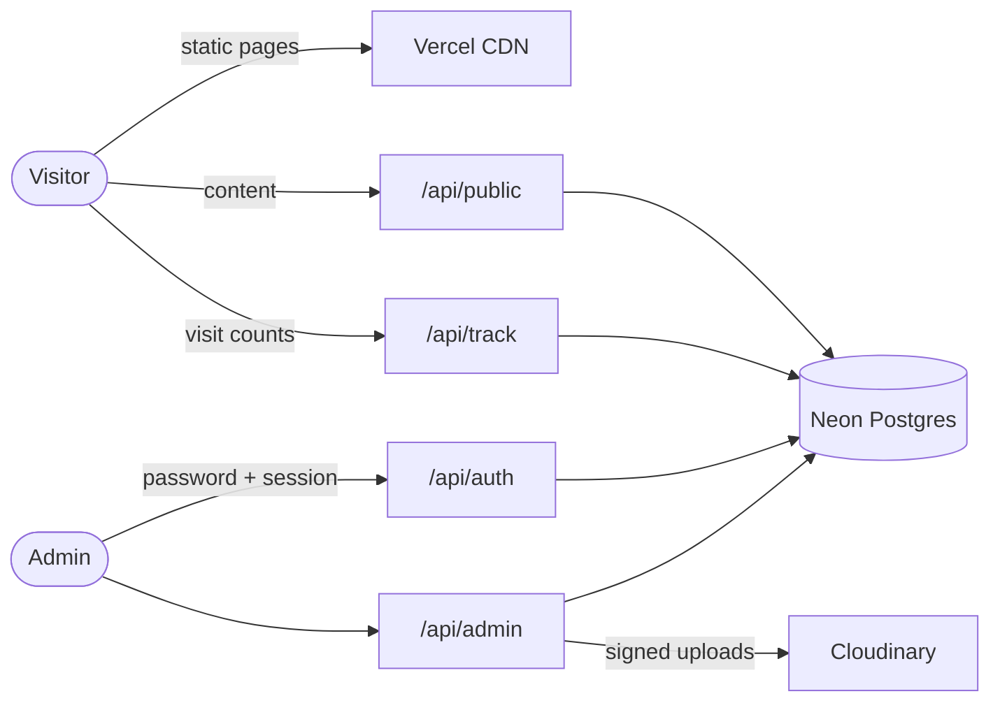

<div align="center">

<a href="https://kotoha-fansite.vercel.app">
  
</a>

# Kotoha Fan Site · ことはファンサイト

**An unofficial, non-profit, bilingual fan site for Kotoha (ことは)** 🍀<br>
ハコニワリリィのボーカル・ことはの、非公式・非営利のファンサイト

<sub>By <a href="https://moekoworks.vercel.app">Moeko Works</a></sub>

<br>

[](https://kotoha-fansite.vercel.app)
[](https://kotoha-fansite.vercel.app)

[-f2a7c3)](#tech-stack)
[](https://vercel.com)
[](https://neon.tech)
[](https://cloudinary.com)
[-4c8a3f)](LICENSE)
[](#features)

[**Visit the site**](https://kotoha-fansite.vercel.app) ·
[Features](#features) ·
[Tech stack](#tech-stack) ·
[Run it locally](#run-it-locally) ·
[Corrections & removals](#corrections-and-removals)

</div>

---

## About

Kotoha (ことは) is the vocalist of **HaKoniwalily (ハコニワリリィ)** and a HoneyWorks support vocalist, who debuted as a
VTuber with AiceClass in 2023. This fan site gathers her latest works, news, discography and fan art in one place, in
Japanese and English.

Its design, **"Clover Scrapbook"**, turns the page into a scrapbook: paper notes taped onto artwork, die-cut stickers,
stitched borders, and an artwork backdrop that crossfades between sections. Every entrance is timed to one tempo
(128 BPM), so the motion feels coordinated, and a Motion switch turns it all calm.

It's made by a fan, for fans: no ads, no tracking cookies, no money involved, and fan art is always credited.

## Features

### For visitors

- 🍀 **Arrive in style.** A loader of at least 3 s shows one of three artworks while everything preloads: two clovers
  spin, petals fill with real progress, "Did you know?" facts rotate, and an iris opens onto Home.
- 🌐 **Read in your language.** Visitors in Japan get Japanese, everyone else English. The switcher changes everything.
- 🧭 **Glide through sections.** On desktop the page glides to the next section; phones scroll freely while the
  backdrop crossfades.
- 📺 **Catch the next stream.** A countdown to the regular Tuesday and Friday ~21:00 JST streams, this week's schedule,
  the newest video, the latest news and the next release.
- 💚 **Get to know Kotoha.** A profile card with her birthday, debut, height, activities, fan name, hashtags and favourites.
- 🎬 **Watch and read everything.** All videos and news, newest first, with privacy-enhanced YouTube embeds.
- 💿 **Explore the discography.** Every release with its cover and a "coming soon" card.
- 🖼️ **Browse fan art.** An infinite masonry gallery whose lightbox grows out of the tapped tile, with the artist and
  source credited.
- ✨ **Turn motion off.** The site remembers the choice and always respects the device's reduced-motion setting.
- 🎉 **Celebrate.** Clover confetti on her birthday (June 10) and debut day (July 8).

### For the admins

- 🔐 **Sign in safely.** The first login forces a password change, with leaked-password checks and lockouts after
  repeated failures.
- 📝 **Publish content.** Paste a YouTube link and the title and thumbnail are looked up; manage news, achievements and
  releases, with drafts.
- 🖌️ **Upload fan art.** Signed direct uploads to Cloudinary that shrink files to the free-tier limits, with credits.
- ♻️ **Never lose anything.** Deleting archives an item with the reason, who and when; anything can be restored.
- 👥 **Manage the team.** The owner creates numbered admin accounts with temporary passwords, and resets or removes them.
- 📊 **Watch the numbers.** A dashboard with content counts, an activity log and cookieless visitor statistics for
  7, 30, 90 and 365 days.

## Tech stack

| Layer     | Choice                                                                                                                                                       |
| --------- | ------------------------------------------------------------------------------------------------------------------------------------------------------------ |
| Front end | **No build step**: semantic HTML, modern CSS (cascade layers, `@property`, scroll-driven animations, View Transitions) and native ES modules                  |
| Motion    | [GSAP](https://gsap.com) (arrival choreography, SplitText), [canvas-confetti](https://github.com/catdad/canvas-confetti), [Lucide](https://lucide.dev) icons |
| Back end  | Four grouped [Vercel Functions](https://vercel.com/docs/functions) on Node.js: `public`, `auth`, `admin`, `track`                                            |
| Database  | [Neon](https://neon.tech) Postgres over the HTTP driver (with retries), plain SQL migrations                                                                  |
| Media     | [Cloudinary](https://cloudinary.com) for fan art; privacy-enhanced YouTube embeds                                                                            |
| Auth      | Argon2id password hashing, `__Host-` session cookies, leaked-password checks, login lockouts                                                                 |
| Analytics | First-party and cookieless: a daily-salted visitor hash, IPs never stored, 90-day raw events with daily totals                                               |
| Hosting   | [Vercel](https://vercel.com) (region `sin1`) with a strict Content Security Policy, Subresource Integrity and HSTS                                           |



## Run it locally

**Requirements:** Node.js 22 or newer, and a Neon (or any Postgres) database.

```bash
git clone https://github.com/PastelSalt/kotoha-fansite.git
cd kotoha-fansite
npm install
cp .env.example .env.local     # fill in the values; never commit this file
npm run db:migrate && npm run db:seed
npm run admin:bootstrap        # creates the Owner account once
node --env-file=.env.local scripts/dev-server.js   # http://localhost:3000
```

The dev server mirrors the Vercel rewrites and headers. `npm run dev` (`npx vercel dev`) works too. Add `?lang=ja` or
`?lang=en` to test languages, and `?debug` to expose the scroll internals.

<details>
<summary><b>All scripts</b></summary>

| Command                   | What it does                                                                              |
| ------------------------- | ----------------------------------------------------------------------------------------- |
| `npm run dev`             | `npx vercel dev`                                                                          |
| `npm run db:migrate`      | Apply the ordered SQL migrations in `db/migrations/` (`npm run db:status` lists them)     |
| `npm run db:seed`         | Run the idempotent `db/seed.sql`                                                          |
| `npm run admin:bootstrap` | Create the Owner account from the bootstrap values in `.env.local`                        |
| `npm run gallery:seed`    | Seed eight credited fan artworks (idempotent)                                             |
| `npm run images:optimize` | Optimise the site images with sharp                                                       |
| `npm run prelaunch:reset` | Dry run of a full reset; `-- --yes-reset-everything` runs it (only right before a launch) |

</details>

## Project structure

```text
public/      the static site: index.html, login.html, admin.html, css/ (v2/ is the design system), js/, locales/, assets/
api/         Vercel Functions, grouped: public, auth, admin, track
lib/         shared server code: database, auth, passwords, validation, analytics, Cloudinary
db/          SQL migrations and the seed
scripts/     migrate, seed, admin bootstrap, image optimisation, local dev server
docs/        design system and Japanese review list; plans/ (how it was built) and research/ (data sheets)
assets/      source artwork; references/ holds the original design mock-ups
```

Content is never hard-deleted by the app: deleted items move to the `archived_content` table. Every push to `main`
deploys production on Vercel; other branches get protected previews. Secrets live in Vercel and in the git-ignored
`.env.local` only.

## Corrections and removals

Spotted a mistake or a missing credit, or want something taken down? Removal requests are honoured, no questions asked.

- **Artists and rights holders:** use the [Moeko Works contact form](https://moekoworks.vercel.app/contact).
- **Fixes and suggestions:** [open an issue](https://github.com/PastelSalt/kotoha-fansite/issues).
- **Security problems:** please report privately, see [SECURITY.md](SECURITY.md).

## Credits

- **Kotoha** (ことは) · AiceClass, for the character and official art. 🍀
- Fan art © each artist, credited on the site.
- Japanese text written by the developer is listed for native review in [docs/JA_REVIEW_LIST.md](docs/JA_REVIEW_LIST.md).
- Made by [Moeko Works](https://moekoworks.vercel.app).

## Project details

|               |                                                                     |
| ------------- | ------------------------------------------------------------------- |
| **Student**   | Kyle Q. Zoleta                                                      |
| **Category**  | Fan site / entertainment                                            |
| **Role**      | Solo developer: design, front end, back end, admin panel, analytics |
| **Timeline**  | September 2026 – present                                            |
| **Status**    | In production at <https://kotoha-fansite.vercel.app>                |
| **Portfolio** | [Moeko Works](https://moekoworks.vercel.app)                        |

## License

The **source code** is released under the [MIT License](LICENSE). See [NOTICE.md](NOTICE.md) for what it doesn't cover.

The **content is not**: Kotoha's name, likeness and official art, the fan art, and video and song titles, thumbnails
and media belong to their respective owners and are used here non-commercially as a fan tribute. If you reuse the code,
replace the content with your own.

<div align="center">
<br>
<sub>This is an unofficial fan project. It is not affiliated with or endorsed by Kotoha, HaKoniwalily, HoneyWorks or
AiceClass.</sub>
<br><br>
<sub>🍀</sub>
</div>
